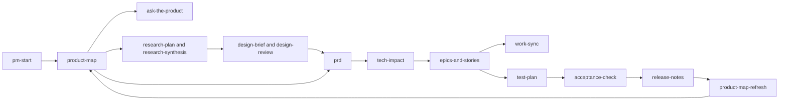

# PM Harness

Agent Skills that turn any codebase into a product knowledge base a product manager can
read, then run research, design, specs, stories, QA, AI evals, and release on top of that
shared context.

New PMs on large products spend months piecing together how things work from tickets,
meetings, and people's memories. Meanwhile the answer is in the code, which most PMs cannot
read. The harness has your coding agent read the code for you, write down how the
product works in plain language with a link to the code behind every claim, and then use
that knowledge in every later step of the job. It never edits the product code. Everything
it writes lives in a `pm/` folder, as markdown your whole team can read and review.

Works with any agent that supports the open [Agent Skills](https://agentskills.io)
standard: Claude Code, Codex, Cursor, GitHub Copilot, Antigravity, and others.
The scripts need only Python 3.10 or later, with no packages to install.

## What it looks like

Every example below is real output from running the skills on
[Medusa](https://github.com/medusajs/medusa), a large open-source commerce platform (a
TypeScript monorepo with about 35 modules). Browse it all in [examples/medusa](examples/medusa/).

**1. "Map this product for me."** The `product-map` skill writes
[an overview](examples/medusa/pm/product/OVERVIEW.md),
[20 capabilities](examples/medusa/pm/product/capabilities.md) with the errors users can hit,
[five user journeys](examples/medusa/pm/product/journeys/), a
[data model](examples/medusa/pm/product/data-model.md), a
[glossary](examples/medusa/pm/product/domain-glossary.md), and
[open questions](examples/medusa/pm/product/open-questions.md) for engineering. Every claim
cites a file. This row is from the checkout journey's "What can go wrong" table:

| When | What the shopper gets | What is undone | Code |
|------|-----------------------|----------------|------|
| Bank needs 3-D Secure | `type: "cart"` with "More information is required for payment"; shopper completes 3-D Secure and the storefront retries | Same undo as above; payment session is kept so the retry can succeed | `packages/core/core-flows/src/payment/steps/authorize-payment-session.ts:85-90` |

**2. "Can a shopper use more than one promo code?"** `ask-the-product` checks the
knowledge base, confirms in the code, answers in plain language with a confidence level,
and saves the answer to the [FAQ](examples/medusa/pm/product/faq.md) so nobody asks twice.

**3. "Write a PRD for telling shoppers why a promo code did not apply."** `prd` starts from
an open question the map raised and describes current behavior with citations. It
found that Medusa already works out why a code was skipped, and that the store API
throws the reason away. `tech-impact` turned that into the cheapest first step for
engineering. See the [whole initiative](examples/medusa/pm/initiatives/promo-code-feedback/).

**4. "Break it into stories."** `epics-and-stories` writes
[2 epics and 5 stories](examples/medusa/pm/initiatives/promo-code-feedback/stories/) with
numbered Given/When/Then acceptance criteria, and a script checks every must-have
requirement has a story. `test-plan` adds the cases the code suggests and a script
confirms all 19 acceptance criteria have a test.

**5. "Does this PR do what story 001 asked?"** `acceptance-check` read a
[sample diff](examples/medusa/sample-pr/promo-reasons.diff) and reported
[Not ready](examples/medusa/pm/initiatives/promo-code-feedback/acceptance/AC-promo-code-feedback-sample-pr.md):
the behavior is there, but the new test imports a helper that does not exist, and the
SDK change was not in any story.

**6. "Write this week's status update."** `status-update` built
[the update](examples/medusa/pm/initiatives/promo-code-feedback/status/2026-10-30.md) from
the files, with the status color, the blockers, and the decisions needed.

## Install

With the [skills CLI](https://github.com/vercel-labs/skills), no clone needed:

```bash
npx skills add bharal-sahab/pm-harness                       # all skills
npx skills add bharal-sahab/pm-harness --skill product-map   # just one
```

Or clone this repository and run the installer from inside your product repository:

```bash
/path/to/pm-harness/scripts/install.sh                         # into .agents/skills (Codex, Cursor, Copilot, ...)
/path/to/pm-harness/scripts/install.sh --agents universal,claude   # also .claude/skills (Claude Code)
/path/to/pm-harness/scripts/install.sh --global                # for every repo on your machine
/path/to/pm-harness/scripts/install.sh --copy                  # copy instead of symlink, for teammates or CI
```

Then open your agent in the product repository and say **"Where do I start?"**. The
`pm-start` skill checks what exists, sets up `pm/`, and tells you which skill to run next.

## The skills

| Stage | Skill | What it does |
|-------|-------|--------------|
| Start | `pm-start` | Sets up `pm/`, reports where every initiative stands, and routes you to the right skill. |
| Understand | `product-map` | Scans the codebase and writes the product knowledge base in `pm/product/`. |
| | `ask-the-product` | Answers "how does X work?" from the knowledge base and the code, and saves answers to the FAQ. |
| | `product-map-refresh` | Updates the knowledge base after code changes, using git history, and writes a changelog. |
| Research | `research-plan` | Plans research that changes a decision: hypotheses, method, recruiting, interview guide. |
| | `research-synthesis` | Turns notes and tickets into evidence-backed insights, checks them against the product, and writes a problem brief. |
| | `competitive-scan` | Compares competitors against your capabilities, with sources for every claim. |
| Design | `design-brief` | Gives designers the current flow, every screen and state, the copy needed, and components to reuse. |
| | `design-review` | Reviews Figma files or screenshots for missing states, missing copy, and things the API cannot provide. |
| Define | `prd` | Writes a PRD with numbered requirements and cited current behavior. |
| | `tech-impact` | Shows engineering impact in plain language: where each requirement lands, risks, size, questions. |
| | `epics-and-stories` | Splits a PRD into epics and stories with testable acceptance criteria, and checks coverage. |
| | `work-sync` | Pushes stories to Jira or Linear (through their MCP servers or CSV import) and pulls status back. |
| Verify | `test-plan` | Writes a test plan from the acceptance criteria and the code's edge cases. |
| | `acceptance-check` | Checks a pull request or branch against the stories it claims to deliver. |
| | `ai-evals` | Builds evals for AI features: error analysis, failure taxonomy, judges validated against human labels. |
| Ship | `release-notes` | Writes user, internal, and changelog notes for what verifiably shipped. |
| | `status-update` | Writes an honest status update from the artifacts and tracker state. |



Each skill works alone, too. You can install only `product-map` and `ask-the-product` to
get oriented on a new product.

## How it works

- **One folder, `pm/`, in your product repository.** `pm/product/` describes the product as
  built. `pm/initiatives/<name>/` holds one piece of work from research to release.
  `pm/decisions/` records decisions. The conventions are in
  [schemas/artifact-frontmatter.md](schemas/artifact-frontmatter.md), and each `pm/` gets a
  copy.
- **Artifacts link to what they came from.** Every file has a small header (ID, type,
  status, and `derived_from`), so a story traces back to its PRD, the PRD to research, and
  everything to the code it cites. A checker script validates the links and citations.
- **Claims cite code.** Statements about behavior point to a file and often a line. If the
  code cannot settle something, it goes to open questions instead of being guessed.
- **The PM stays in charge.** Skills stop at checkpoints for your confirmation before
  writing anything important, and anything pushed to a tracker needs your go-ahead.
- **Markdown is the source of truth, and trackers are optional.** Jira and Linear get
  content from `pm/`, and status flows back. Without a tracker, everything still works.
- **Skills never change product code.** They only write inside `pm/`.

## How we test it

- [evals/](evals/) holds 20 golden questions about Medusa that a PM would ask, each
  with key points and a rubric. The first run [failed](evals/results/medusa-run1/report.md)
  on one question because the map did not record user-facing errors. We fixed the
  `product-map` skill, and the [second run](evals/results/medusa-run2/report.md) passed all 20.
- CI ([.github/workflows/ci.yml](.github/workflows/ci.yml)) does three things on every change:
  - validates every skill against the Agent Skills spec;
  - runs every script on the example;
  - downloads Medusa at the exact commit the example was built from and checks that every
    citation resolves.
- [evals/run-cross-agent.sh](evals/run-cross-agent.sh) runs the same questions headless
  through Claude Code, Codex, or Cursor, so you can compare agents.

## Limits

- This is version 0.1. The skills were developed and tested on one pilot (Medusa, a web
  and API platform). Mobile apps and other stacks need more pilots.
- Cross-agent runs have a script but no published results yet.
- Quality depends on the agent and model. The checker catches broken citations and links,
  not wrong conclusions. Read the open questions, and spot-check claims you will act on.
- Medusa's Enterprise-licensed code (role-based access and single sign-on) was excluded
  from the example on purpose.

## Contributing

See [CONTRIBUTING.md](CONTRIBUTING.md). The rules for editing skills are in
[AGENTS.md](AGENTS.md).

## License

[Apache-2.0](LICENSE). Example output quotes file paths from Medusa, which is MIT-licensed.
