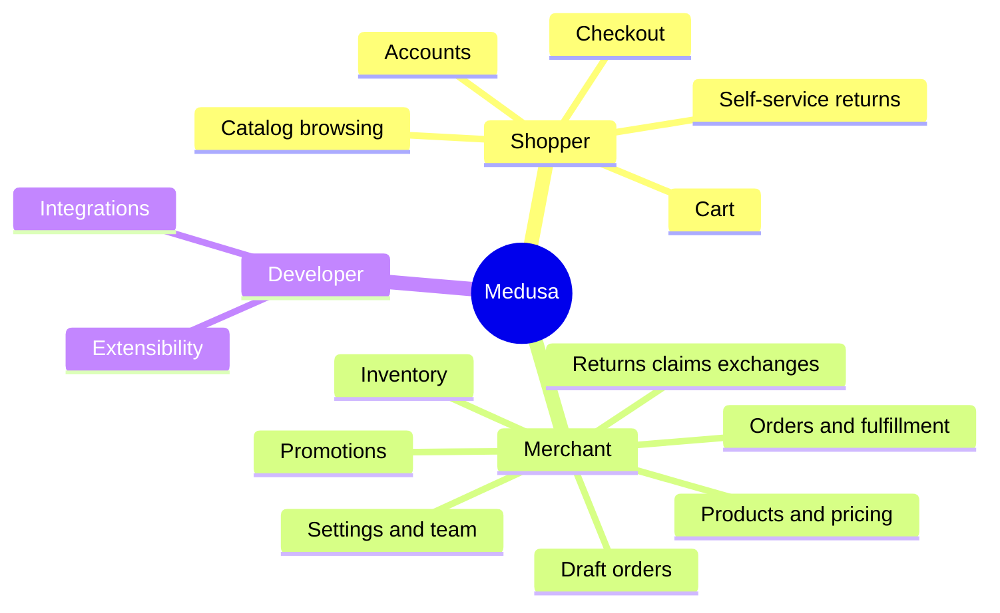

# Medusa overview

> Generated by the `product-map` skill from commit `2cfefbd`. Start here.

## In one paragraph

Medusa is an open-source commerce platform: the backend that runs an online store. It
manages the catalog, prices, promotions, carts, checkout, payments, orders, shipping, stock
and returns, and exposes them through APIs. Merchants operate the business in a bundled
admin dashboard. Shoppers never see Medusa directly; they use a storefront or app that a
merchant builds on the Store API `packages/medusa/src/api/store/`. Developers can extend
almost every part of it `packages/core/core-flows/src/`.

## Who uses it

| Audience | What they do with it | Where (surface) |
|----------|----------------------|-----------------|
| Shoppers | Browse, buy, manage account, request returns | Merchant's storefront via the Store API |
| Merchant staff | Run catalog, pricing, promotions, orders, stock, settings | Admin dashboard `packages/admin/dashboard/src/routes/` |
| Developers | Build storefronts, customize workflows, add integrations, host | Code, JS SDK, CLI `packages/core/js-sdk/src/index.ts` |

## Platforms and surfaces

- **API platform:** Store, Admin and Auth APIs served by one Node.js server `packages/medusa/src/api/`.
- **Web admin:** React dashboard served by the same server at `/app` `packages/medusa/src/loaders/admin.ts`.
- **No storefront or mobile app** in this repository; a Next.js starter is downloaded by the
  project creator `packages/cli/create-medusa-app/src/utils/clone-repo.ts`.

## Capability map

See [capabilities.md](capabilities.md) for all 20 capabilities with IDs.

## Key journeys

| Journey | Why it matters |
|---------|----------------|
| [Checkout](journeys/checkout.md) | The revenue path; has the richest failure handling |
| [Promotions at checkout](journeys/promotions-at-checkout.md) | Most common source of "why didn't my discount work" |
| [Order fulfillment](journeys/order-fulfillment.md) | Daily merchant operations and cancellation rules |
| [Returns, claims and exchanges](journeys/returns-claims-exchanges.md) | Post-purchase cost and support load |
| [Customer accounts](journeys/customer-accounts.md) | Guest vs registered behavior |

## How it is built (one paragraph)

Each business area is a separate module with its own data; connections between areas are
stored as links. Every action that changes data runs as a workflow whose steps can undo
themselves, which is why a failed checkout never leaves a half-made order. Outside services
(Stripe, SendGrid, S3) plug in as providers. Only PostgreSQL is required; Redis is recommended
in production. More in [how-it-is-built.md](how-it-is-built.md).

## Reading paths

- **First day:** this page, [capabilities.md](capabilities.md), [checkout](journeys/checkout.md), [domain-glossary.md](domain-glossary.md).
- **Before writing a spec:** the related capability, its journeys, [data-model.md](data-model.md).
- **Before talking to engineering:** [how-it-is-built.md](how-it-is-built.md), [integrations.md](integrations.md), [open-questions.md](open-questions.md).
- **Questions other PMs already asked:** [faq.md](faq.md).

## Coverage and confidence

Mapped at **standard** depth: all shopper and merchant capabilities, five journeys, data
model, integrations and architecture. **Excluded:** Enterprise-licensed role-based access
control and SSO (listed in the repository's Enterprise license; see `_meta.yaml`), the
documentation sites in `www/`, and test suites. Confidence is high for checkout, orders,
promotions and accounts (code read end to end), medium for shipping-rule evaluation,
taxes and translations.
