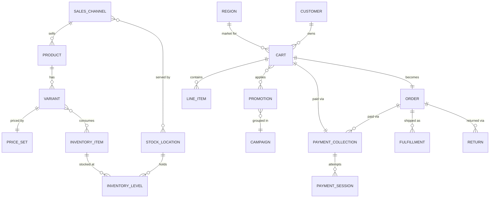

# Data model, in plain language

Medusa splits data by business area into separate **modules** (Product, Cart, Order,
Payment...). Modules never point at each other directly; connections between them are kept
in separate **link** records. For a PM this mostly means: any relationship crossing two
modules (for example "which promotions did this order use") is a link, and adding a new one
is a normal, supported change `packages/modules/link-modules/src/definitions/`.

## Map

## Entities

### Product and Variant

A product is what shoppers browse; a variant is what they buy (a specific size and color)
`packages/modules/product/src/models/product.ts`, `packages/modules/product/src/models/product-variant.ts`.

- **States (product):** `draft` -> `proposed` -> `published`, or `rejected` `packages/core/utils/src/product/enums.ts`
- **Key variant fields:** SKU, barcode; `manage_inventory` (track stock, default on); `allow_backorder` (sell when out of stock, default off)
- **Belongs to:** at most one collection and one shipping profile; many categories, tags, sales channels.

### Price, Price Set, Price List

Each variant has a price set holding prices per currency, optionally per region and
quantity range `packages/modules/pricing/src/models/price.ts`. Price lists layer sales or
overrides on top, with `draft`/`active` states and optional dates `packages/modules/pricing/src/models/price-list.ts`.

### Cart and Line Item

The basket before checkout `packages/modules/cart/src/models/cart.ts`. A cart has **no status
field**: it is open until `completed_at` is set at checkout. Line items store a snapshot of
product title, SKU and price, so later catalog edits do not change an open cart's history
`packages/modules/cart/src/models/line-item.ts`. Discounts are stored as adjustments on items and shipping.

### Order

The confirmed purchase `packages/modules/order/src/models/order.ts`.

- **States:** `pending`, `completed`, `draft`, `archived`, `canceled`, `requires_action` `packages/core/utils/src/order/status.ts`
- **Payment status (calculated):** `not_paid`, `awaiting`, `authorized`, `partially_authorized`, `captured`, `partially_captured`, `partially_refunded`, `refunded`, `canceled`, `requires_action` `packages/core/types/src/order/common.ts`
- **Fulfillment status (calculated):** `not_fulfilled`, `partially_fulfilled`, `fulfilled`, `partially_shipped`, `shipped`, `partially_delivered`, `delivered`, `canceled` `packages/core/core-flows/src/order/utils/aggregate-status.ts`
- **Versioned:** each confirmed change (return, claim, exchange, edit) creates a new version; item quantities track ordered, fulfilled, shipped, delivered, returned and written off `packages/modules/order/src/models/order-item.ts`
- **Order change states:** `requested`, `pending`, `confirmed`, `declined`, `canceled` `packages/core/utils/src/order/order-change.ts`
- **Draft orders** are orders with status `draft` and `is_draft_order` set.

### Return, Claim, Exchange

- **Return states:** `open`, `requested`, `received`, `partially_received`, `canceled` `packages/core/utils/src/order/status.ts`
- **Claim types:** `refund`, `replace`. Claims and exchanges have no status field, only a canceled date `packages/modules/order/src/models/claim.ts`, `packages/modules/order/src/models/exchange.ts`

### Payment Collection, Payment Session, Payment, Refund

A payment collection is "the amount owed" for a cart, order, claim or exchange. A payment
session is one attempt with one provider. A payment is an authorized session; captures and
refunds hang off it `packages/modules/payment/src/models/payment-collection.ts`.

- **Collection states:** `not_paid`, `awaiting`, `authorized`, `partially_authorized`, `canceled`, `failed`, `partially_captured`, `completed` `packages/core/utils/src/payment/payment-collection.ts`
- **Session states:** `pending`, `requires_more`, `authorized`, `captured`, `error`, `canceled`, `pending_authorization` `packages/core/utils/src/payment/payment-session.ts`
- **Refund states:** `pending`, `succeeded`, `failed` `packages/core/utils/src/payment/refund.ts`
- **Account holder:** a customer's saved profile at a payment provider (for example a Stripe customer) `packages/modules/payment/src/models/account-holder.ts`

### Inventory Item, Level, Reservation

Inventory is tracked per **inventory item** per **stock location** (level). Available =
stocked minus reserved `packages/modules/inventory/src/models/inventory-level.ts`. A reservation holds
stock for an order line and has no status `packages/modules/inventory/src/models/reservation-item.ts`.

### Fulfillment and shipping setup

A fulfillment is one shipment, with packed, shipped, delivered and canceled dates (no status
field) `packages/modules/fulfillment/src/models/fulfillment.ts`. Shipping setup is a chain: stock
location -> fulfillment set -> service zone (geography) -> shipping option (price, rules)
`packages/modules/fulfillment/src/models/service-zone.ts`.

### Promotion and Campaign

- **Promotion:** code or automatic, `standard` or `buyget`, states `draft`/`active`/`inactive`, optional usage limit `packages/modules/promotion/src/models/promotion.ts`
- **Application method:** `fixed` or `percentage`; targets `order`, `items` or `shipping_methods`; allocation `each`, `across` or `once` `packages/modules/promotion/src/models/application-method.ts`
- **Campaign budget:** `spend`, `usage`, `use_by_attribute`, `spend_by_attribute` `packages/modules/promotion/src/models/campaign-budget.ts`

### Customer and Customer Group

A customer has `has_account` true (registered) or false (guest); the pair (email,
has_account) is unique `packages/modules/customer/src/models/customer.ts`. Groups drive price lists and promotions.

### Region, Sales Channel, Store

- **Region:** countries + one currency + `automatic_taxes` `packages/modules/region/src/models/region.ts`
- **Sales channel:** where you sell; can be disabled `packages/modules/sales-channel/src/models/sales-channel.ts`
- **Store:** global defaults (default region, sales channel, location; supported currencies and locales) `packages/modules/store/src/models/store.ts`

### Users, API keys, notifications

- **User / Invite:** admin staff; invites carry a token and expiry `packages/modules/user/src/models/invite.ts`
- **API key:** `publishable` (storefront) or `secret` (server-to-server), revocable `packages/modules/api-key/src/models/api-key.ts`
- **Notification:** log of outbound messages with `pending`/`success`/`failure` `packages/modules/notification/src/models/notification.ts`

## Where the data lives

Everything is stored in one PostgreSQL database, one set of tables per module plus link
tables `packages/core/utils/src/common/define-config.ts`. Optional Redis holds queues, locks and
caches, not business records. Payment details live at the payment provider (for example
Stripe); Medusa stores references and statuses.
