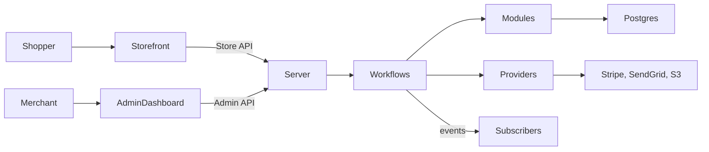

# How it is built (for PMs)

## The big picture

Medusa is a commerce **backend** written in TypeScript on Node.js. Shoppers reach it
through a storefront the merchant builds (Medusa offers a separate Next.js starter; there is
no storefront or mobile app in this repository). Merchants use the bundled React admin
dashboard. Every action that changes data runs as a **workflow**: a sequence of steps where
each step knows how to undo itself, so a failure halfway leaves no half-done order. Workflows
call **modules** (one per business area) that store data in PostgreSQL, and **providers**
that talk to outside services `packages/medusa/src/loaders/index.ts`.

## The building blocks

| Block | What it is (plain words) | Why a PM should care | Where |
|-------|--------------------------|----------------------|-------|
| Module | The part of the system that owns one business area and its data | Changes inside one module are contained; cross-module features need links | `packages/modules/` |
| Link | A connection between two modules' records | New relationships (e.g. "order has a gift message") are cheap to add | `packages/modules/link-modules/src/definitions/` |
| Workflow | A step-by-step process with automatic undo | Business rules and failure handling live here; most specs map to one workflow | `packages/core/core-flows/src/` |
| Hook | A pre-built slot in a workflow for custom logic | Lets teams add rules (e.g. fraud checks) without forking core | `packages/core/workflows-sdk/src/utils/composer/create-hook.ts` |
| Event and subscriber | A signal after something happens, and code that reacts | Emails, syncs and loyalty run here; failures do not block checkout | `packages/core/framework/src/subscribers/subscriber-loader.ts` |
| Scheduled job | Work that runs on a timer | Nightly syncs, reminders | `packages/core/framework/src/jobs/job-loader.ts` |
| Provider | Plug-in for an outside service | Payment, email, files, login are swappable | `packages/modules/providers/` |
| API route | A file per URL path | Adding an endpoint is a new file | `packages/core/framework/src/http/routes-loader.ts` |
| Query | One call that fetches data across modules | Reporting and screens can combine data without new backend code | `packages/core/query/src/query/query.ts` |
| Feature flag | An on/off switch read at startup | In-progress features ship dark | `packages/medusa/src/feature-flags/` |

## Repository tour

| Folder | What lives there |
|--------|------------------|
| `packages/medusa` | The server: all built-in API routes, startup, CLI commands |
| `packages/core/core-flows` | Every built-in business process (cart, order, payment, returns...) |
| `packages/modules` | Business modules and their data models; providers under `providers/` |
| `packages/admin/dashboard` | The merchant-facing admin app (React) |
| `packages/design-system` | Shared UI components used by the admin |
| `packages/core/js-sdk` | Client library storefronts use |
| `packages/plugins` | Official add-ons: draft orders (on by default), loyalty gift cards |
| `packages/cli` | `medusa` command and `create-medusa-app` project starter |
| `integration-tests` | End-to-end API tests against a real database |
| `www` | Documentation websites (not part of the product) |

## What makes changes easy or hard here

- **Easy:** adding a payment, email or file provider; adding fields to an entity through a
  link; reacting to events; adding admin widgets on existing pages
  `packages/admin/admin-shared/src/extensions/widgets/constants.ts`.
- **Easy:** custom checks at checkout through the `validate` hook
  `packages/core/core-flows/src/cart/workflows/complete-cart.ts:403-406`.
- **Harder:** anything that changes order money math or order versioning (returns, claims,
  exchanges and edits all share one engine) `packages/modules/order/src/models/order-change.ts`.
- **Harder:** split payments; the code explicitly does not support them yet
  `packages/core/core-flows/src/payment-collection/workflows/create-payment-session.ts:218-224`.
- **Operational:** a single server runs fine with only PostgreSQL; multiple servers need
  Redis for queues and locks `packages/core/utils/src/common/define-config.ts`.

## Technical terms you will hear

- **Compensation:** the undo step of a workflow step.
- **Idempotent:** safe to run twice without doing the thing twice (checkout is).
- **Publishable key:** the public storefront ID sent on every Store API call.
- **Actor type:** who is logged in: `customer` (shopper) or `user` (staff).
- **Worker mode:** running background jobs on separate servers from the API.
- **Migration:** a change to how data is stored; generated from model changes.
- **Changeset:** how engineers record a release note for a package.

Business terms are in the [glossary](domain-glossary.md).
