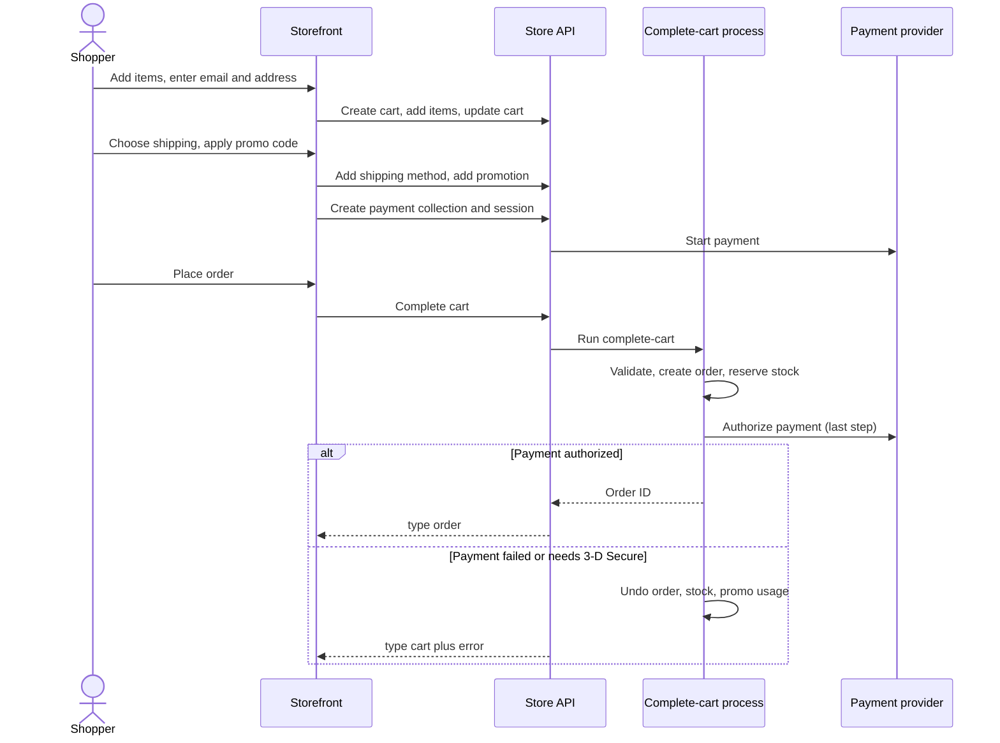

# Journey: checkout

**Actor:** Shopper (guest or logged in)  **Trigger:** Shopper clicks "Place order"
**Outcome:** An order exists, stock is reserved, payment is authorized, and an
"order placed" signal goes out so emails and other systems can react.

Medusa has no built-in storefront. A storefront (for example the separate Next.js starter)
calls the Store API in the order below. Everything here is what the backend guarantees no
matter which storefront is used.

## The flow

## Step by step

| # | What the shopper does or sees | What the system does | Code |
|---|-------------------------------|----------------------|------|
| 1 | Opens the store | Storefront sends its publishable key on every call; the key decides the sales channel | `packages/core/framework/src/http/middlewares/ensure-publishable-api-key.ts` |
| 2 | Adds the first item | Creates a cart for a region (default region if none given) in the region's currency; finds or creates a guest customer when an email is present | `packages/core/core-flows/src/cart/workflows/create-carts.ts` |
| 3 | Adds more items or changes quantity | Prices each item for this customer, region, currency and quantity; checks stock; refreshes taxes, discounts and payment | `packages/core/core-flows/src/cart/workflows/add-to-cart.ts`, `packages/core/core-flows/src/cart/workflows/refresh-cart-items.ts` |
| 4 | Enters email and shipping address | Validates the country belongs to the region; recalculates tax when the address changes | `packages/core/core-flows/src/cart/workflows/update-cart.ts:72-112` |
| 5 | Sees shipping choices | Lists options served by locations linked to the cart's sales channel, filtered by zone rules | `packages/core/core-flows/src/cart/workflows/list-shipping-options-for-cart.ts` |
| 6 | Picks a shipping option | Validates option and price; replaces any earlier choice for the same shipping profile | `packages/core/core-flows/src/cart/workflows/add-shipping-method-to-cart.ts` |
| 7 | Enters a promo code | Applies valid codes as discounts on items or shipping; invalid codes are skipped | `packages/core/core-flows/src/cart/workflows/update-cart-promotions.ts` |
| 8 | Chooses a payment method | Creates a payment collection for the cart total, then a payment session with the provider; deletes older sessions | `packages/core/core-flows/src/cart/workflows/create-payment-collection-for-cart.ts`, `packages/core/core-flows/src/payment-collection/workflows/create-payment-session.ts` |
| 9 | Clicks "Place order" | Runs the complete-cart process (next section) | `packages/medusa/src/api/store/carts/[id]/complete/route.ts` |
| 10 | Sees confirmation | Response has `type: "order"` with the order | `packages/medusa/src/api/store/carts/[id]/complete/route.ts:76-85` |

### Inside "complete cart"

1. Locks the cart so no other request can change or complete it at the same time (waits up to 30 seconds) `packages/core/core-flows/src/cart/workflows/complete-cart.ts:362-366`.
2. Checks the cart has items and a usable payment session (unless the total is zero and covered by credit) `packages/core/core-flows/src/cart/steps/validate-cart-items.ts`, `packages/core/core-flows/src/cart/steps/validate-cart-payments.ts`.
3. If an order already exists for this cart, returns it. This is what prevents duplicate orders on double clicks or retries `packages/core/core-flows/src/cart/workflows/complete-cart.ts:388-411`.
4. Checks shipping covers every item that needs it `packages/core/core-flows/src/cart/steps/validate-shipping.ts`.
5. Creates the order from a snapshot of the cart (prices are not recalculated) with status `pending` `packages/core/core-flows/src/cart/workflows/complete-cart.ts:456-542`.
6. In parallel: links order to cart, promotions and payment; marks the cart completed; reserves stock; records promotion usage; queues the `order.placed` signal `packages/core/core-flows/src/cart/workflows/complete-cart.ts:648-660`.
7. Authorizes payment, deliberately last `packages/core/core-flows/src/cart/workflows/complete-cart.ts:684-691`.
8. Records any immediate capture as a transaction on the order, then releases the lock.

## Business rules

- No account needed. Every email used at checkout becomes a guest customer record `packages/core/core-flows/src/cart/steps/find-or-create-customer.ts`.
- Shoppers cannot set or override item prices `packages/medusa/src/api/store/carts/validators.ts:74-78`.
- One payment method per order (no split payments) `packages/core/core-flows/src/payment-collection/workflows/create-payment-session.ts:218-224`.
- Changing the cart after starting payment wipes the payment session; the storefront must start payment again `packages/core/core-flows/src/cart/workflows/refresh-payment-collection.ts:124-172`.
- The charged amount is the payment session's amount; checkout does not re-check it against the cart total `packages/core/core-flows/src/cart/workflows/complete-cart.ts:82-96`.
- Signals such as `order.placed` are only delivered if the whole process succeeds `packages/core/core-flows/src/common/steps/emit-event.ts`.

## What can go wrong

| Situation | What the shopper experiences | What the system does | Code |
|-----------|------------------------------|----------------------|------|
| Card declined | Stays on checkout; response `type: "cart"` with "Payment authorization failed" (HTTP 200) | Deletes the just-created order, releases stock, reverts promo usage and cart completion | `packages/core/core-flows/src/payment/steps/authorize-payment-session.ts:94-99`, `packages/medusa/src/api/store/carts/[id]/complete/route.ts:37-73` |
| Bank needs 3-D Secure | `type: "cart"` with "More information is required for payment"; shopper completes 3-D Secure and the storefront retries | Same undo as above; payment session is kept so the retry can succeed | `packages/core/core-flows/src/payment/steps/authorize-payment-session.ts:85-90` |
| Deferred payment (e.g. bank transfer) | Order is placed | Order is created without an authorized payment; payment status is updated later | `packages/core/core-flows/src/payment/steps/authorize-payment-session.ts:76-81` |
| Item sold out between cart and checkout | HTTP error (not the friendly `type: "cart"` response) | Reservation fails, order is deleted, payment is never attempted | `packages/modules/inventory/src/services/inventory-module.ts`, `packages/medusa/src/api/store/carts/[id]/complete/route.ts:37-43` |
| Missing shipping method | HTTP error | Validation stops before an order is created | `packages/core/core-flows/src/cart/steps/validate-shipping.ts` |
| No payment session started | HTTP error | Validation stops before an order is created | `packages/core/core-flows/src/cart/steps/validate-cart-payments.ts` |
| Double click or network retry | Same order returned | Lock plus the cart-to-order link prevent a second order | `packages/core/core-flows/src/cart/workflows/complete-cart.ts:388-411` |
| Two requests at the same moment | Second gets "Cart is already being completed by another request" | Conflict error | `packages/medusa/src/api/store/carts/[id]/complete/route.ts:25-30` |
| Failure after payment was captured | Shopper is not charged | Captured payment is refunded automatically, unless another attempt already placed the order | `packages/core/core-flows/src/cart/steps/compensate-payment-if-needed.ts` |

## Events and notifications

- `order.placed`: fired once per successful checkout; anything that sends confirmation emails, syncs to an ERP, or awards loyalty points listens to it `packages/core/utils/src/core-flows/events.ts`. Example listener: the loyalty plugin issues gift cards `packages/plugins/loyalty/src/subscribers/create-gift-card.ts`.
- `reservation-item.created`: one per stock reservation `packages/core/core-flows/src/cart/workflows/complete-cart.ts:672-675`.
- No order confirmation email is sent by default; a notification provider and a listener must be configured (see [integrations](../integrations.md)).

## Open questions

- Should "sold out at checkout" return the friendly `type: "cart"` response like payment errors do? The code has a TODO for this `packages/medusa/src/api/store/carts/[id]/complete/route.ts:40`.
- Invalid promo codes are skipped silently in the Store API response. Does the storefront tell the shopper? See [open questions](../open-questions.md).
