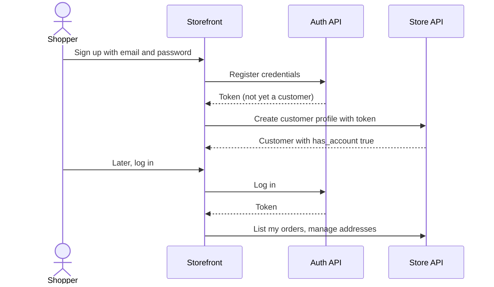

# Journey: customer accounts

**Actor:** Shopper  **Trigger:** Shopper chooses "Create account" or "Log in"
**Outcome:** A registered customer who sees their order history and can reuse addresses.

## The flow

## Step by step

| # | What the shopper does or sees | What the system does | Code |
|---|-------------------------------|----------------------|------|
| 1 | Fills in the sign-up form | Creates login credentials for the "customer" actor with the chosen provider (email and password by default) | `packages/medusa/src/api/auth/[actor_type]/[auth_provider]/register/route.ts` |
| 2 | (automatic) | Creates the customer profile, linked to those credentials; the email must match | `packages/medusa/src/api/store/customers/route.ts`, `packages/core/core-flows/src/customer/workflows/create-customer-account.ts` |
| 3 | Logs in later | Returns a token, or a redirect for Google or GitHub sign-in | `packages/medusa/src/api/auth/[actor_type]/[auth_provider]/route.ts` |
| 4 | Opens "My account" | Profile and address routes require login | `packages/medusa/src/api/store/customers/middlewares.ts` |
| 5 | Opens "My orders" | Lists only this customer's orders | `packages/medusa/src/api/store/orders/route.ts` |
| 6 | Logs in during checkout | Moves the cart to their account and replaces the cart email | `packages/core/core-flows/src/cart/workflows/transfer-cart-customer.ts` |
| 7 | Claims a past guest order | Requests an order transfer; whoever holds the token accepts it | `packages/core/core-flows/src/order/workflows/transfer/request-order-transfer.ts`, `packages/core/core-flows/src/order/workflows/transfer/accept-order-transfer.ts` |

## Business rules

- Guest and registered customers are separate records that can share an email; registering does not merge earlier guest orders automatically `packages/modules/customer/src/models/customer.ts:30-34`.
- An email can have only one registered account `packages/core/core-flows/src/customer/steps/validate-customer-account-creation.ts`.
- Email and password is the only login method on by default; Google and GitHub are optional providers `packages/core/utils/src/common/define-config.ts:273-278`.
- Anyone with an order's ID can view that order without logging in `packages/medusa/src/api/store/orders/[id]/route.ts`.

## What can go wrong

| Situation | What the shopper experiences | What the system does | Code |
|-----------|------------------------------|----------------------|------|
| Email already registered | "Customer with this email already has an account" | Blocks the duplicate | `packages/core/core-flows/src/customer/steps/validate-customer-account-creation.ts` |
| Forgot password | Always told the reset was requested | Creates a reset token and fires `auth.password_reset`; an email is only sent if a listener is configured | `packages/core/core-flows/src/auth/workflows/generate-reset-password-token.ts` |
| Transfer to an account that already owns the order | Error | Rejected | `packages/core/core-flows/src/order/workflows/transfer/request-order-transfer.ts:68-83` |

## Events and notifications

- `auth.password_reset`: needs a listener to email the reset link.
- `order.transfer_requested`: needs a listener to email the original address `packages/core/utils/src/core-flows/events.ts`.

## Open questions

- Do we want guest orders to attach automatically when a shopper registers with the same email? Today it requires an order transfer.
