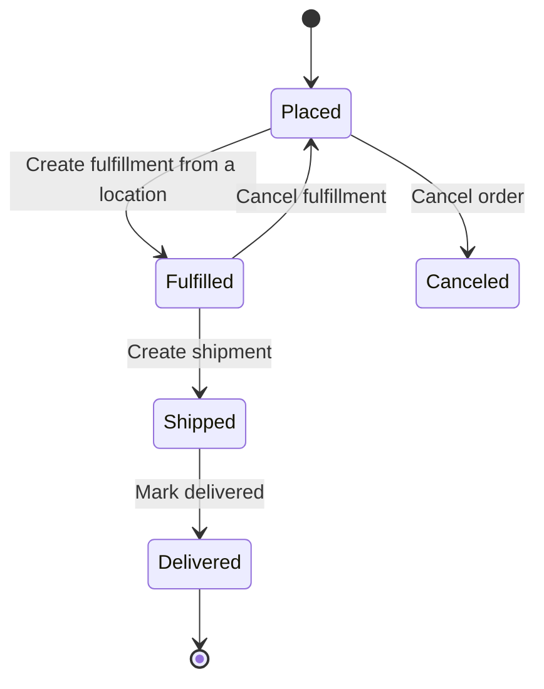

# Journey: order fulfillment

**Actor:** Merchant staff in the Admin dashboard  **Trigger:** A new order appears
**Outcome:** Items are packed, shipped and delivered; stock moves from reserved to shipped.

## The flow

The dashboard shows a payment status and a fulfillment status on each order. Neither is
stored; both are calculated from payments and fulfillments
`packages/core/core-flows/src/order/utils/aggregate-status.ts`.

## Step by step

| # | What the merchant does | What the system does | Code |
|---|------------------------|----------------------|------|
| 1 | Opens Orders | Lists orders; home page redirects here | `packages/admin/dashboard/src/routes/home/home.tsx` |
| 2 | Clicks "Fulfill items" | Checks items exist, order not canceled, a stock location is chosen, and reservations cover tracked items | `packages/core/core-flows/src/order/workflows/create-fulfillment.ts` |
| 3 | Adds tracking, "Mark as shipped" | Records the shipment; cannot ship more than fulfilled | `packages/core/core-flows/src/order/workflows/create-shipment.ts` |
| 4 | "Mark as delivered" | Records delivery; cannot deliver more than fulfilled | `packages/core/core-flows/src/order/workflows/mark-order-fulfillment-as-delivered.ts` |
| 5 | Captures payment (if not automatic) | Captures the authorized amount through the provider | `packages/core/core-flows/src/payment/workflows/capture-payment.ts` |

## Business rules

- Items that need shipping and items that do not must go in separate fulfillments `packages/core/core-flows/src/order/utils/order-validation.ts`.
- Shipped fulfillments cannot be canceled `packages/core/core-flows/src/order/workflows/cancel-order-fulfillment.ts`.
- An order can be canceled only if it is not completed and every fulfillment is canceled. A completed order must go through returns instead `packages/core/core-flows/src/order/workflows/cancel-order.ts:71-104`.
- Canceling an order refunds captured payments, cancels uncaptured ones and releases stock reservations `packages/core/core-flows/src/order/workflows/cancel-order.ts`.
- Only a "manual" fulfillment provider ships with Medusa; label printing and carrier tracking need an add-on provider `packages/modules/providers/fulfillment-manual/src/services/manual-fulfillment.ts`.

## What can go wrong

| Situation | What the merchant sees | Code |
|-----------|------------------------|------|
| Cancel an order with a shipped package | "All fulfillments must be canceled before canceling an order", and shipped ones cannot be canceled | `packages/core/core-flows/src/order/workflows/cancel-order.ts:88-103` |
| Cancel a completed order | "Cannot cancel a completed order. Please use the return process to handle refunds or exchanges." | `packages/core/core-flows/src/order/workflows/cancel-order.ts:81-86` |
| Fulfill more than reserved | Error; reservation must be adjusted first | `packages/core/core-flows/src/order/workflows/create-fulfillment.ts` |

## Open questions

- Marking "delivered" does not appear to require "shipped" first. Is that intended for local pickup? `packages/core/core-flows/src/order/workflows/mark-order-fulfillment-as-delivered.ts`
