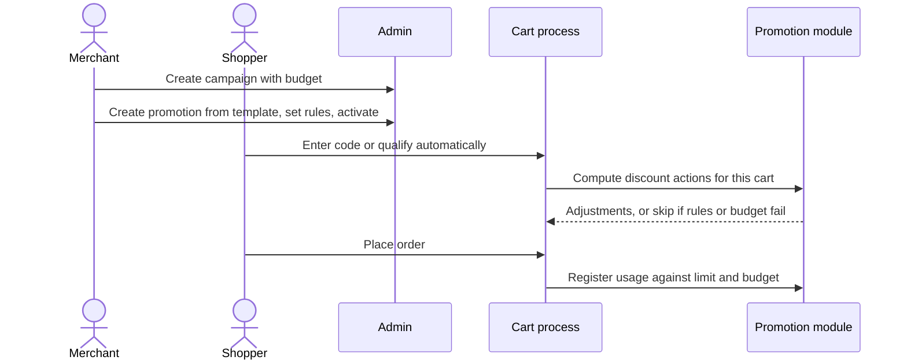

# Journey: promotions at checkout

**Actors:** Merchant (sets up), shopper (redeems)
**Outcome:** The right discount is applied, budget limits hold, and usage is counted once
per placed order.

## The flow

## Step by step

| # | Who | What happens | Code |
|---|-----|--------------|------|
| 1 | Merchant | Picks a template: amount off products or order, percentage off products or order, buy X get Y, free shipping | `packages/admin/dashboard/src/routes/promotions/promotion-create/components/create-promotion-form/templates.ts` |
| 2 | Merchant | Adds targeting rules (customer group, region, country, sales channel, products, categories...) | `packages/medusa/src/api/admin/promotions/utils/rule-attributes-map.ts` |
| 3 | Merchant | Optionally adds it to a campaign with dates and a budget | `packages/modules/promotion/src/models/campaign-budget.ts` |
| 4 | Shopper | Enters a code; automatic promotions apply without one | `packages/core/core-flows/src/cart/workflows/update-cart-promotions.ts` |
| 5 | System | Recalculates on every cart change; discounts are stored as adjustments on items or shipping | `packages/modules/cart/src/models/line-item-adjustment.ts` |
| 6 | System | On order placement, records usage per code and per customer or email | `packages/core/core-flows/src/promotion/steps/register-usage.ts` |

## Business rules

- New promotions start as `draft`; only `active` ones apply `packages/modules/promotion/src/models/promotion.ts`.
- Codes are unique among non-deleted promotions `packages/modules/promotion/src/models/promotion.ts`.
- Fixed-amount promotions need a currency `packages/medusa/src/api/admin/promotions/utils/rule-attributes-map.ts`.
- Budget types: total spend, total uses, spend per customer, uses per customer `packages/core/utils/src/promotion/index.ts`.
- If applying a promotion would exceed its budget, it is not applied `packages/modules/promotion/src/utils/compute-actions/usage.ts`.
- Usage is only counted when an order is placed; a failed checkout rolls it back `packages/core/core-flows/src/promotion/steps/register-usage.ts`.

## What can go wrong

| Situation | What the shopper experiences | Code |
|-----------|------------------------------|------|
| Code does not exist or rules do not match | Code is skipped; the cart comes back without it and no reason is returned by the Store API | `packages/core/core-flows/src/cart/workflows/update-cart-promotions.ts`, `packages/medusa/src/api/store/carts/[id]/promotions/route.ts` |
| Budget exhausted | Discount no longer applies | `packages/modules/promotion/src/utils/compute-actions/usage.ts` |

## Open questions

- Should the Store API tell shoppers why a code was rejected (expired, not eligible, budget used)? The process computes "skipped codes" but the route does not return them.
