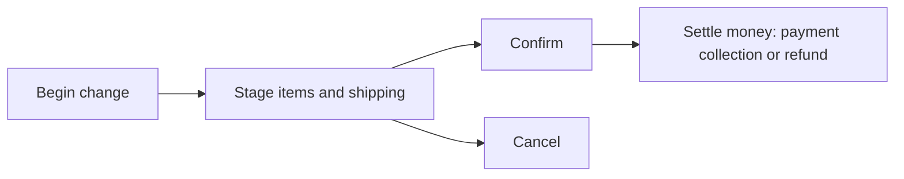

# Journey: returns, claims, exchanges and edits

**Actors:** Shopper (self-service return) and merchant staff (everything else)
**Outcome:** The order reflects what the customer actually kept, and money is settled.

## Which one to use

| Situation | Use | Who starts it |
|-----------|-----|---------------|
| Customer changed their mind | Return | Shopper (Store API) or staff |
| Wrong, missing or broken item (merchant's fault) | Claim: `refund` or `replace` | Staff |
| Customer wants a different size or color | Exchange | Staff |
| Change an order before it ships | Order edit | Staff |

Claim reasons: `missing_item`, `wrong_item`, `production_failure`, `other` `packages/core/utils/src/order/status.ts`.

## The shared mechanism: order changes

All four flows work the same way: **begin** a change, **stage** item and shipping actions,
then **confirm** (or cancel). Each confirmed change bumps the order's version, so history is
kept `packages/modules/order/src/models/order-change.ts`.

## Return, step by step

| # | Who | What happens | Code |
|---|-----|--------------|------|
| 1 | Shopper or staff | Request return for items and quantities, with a reason | `packages/medusa/src/api/store/returns/route.ts`, `packages/core/core-flows/src/order/workflows/return/begin-return.ts` |
| 2 | System | Checks order not canceled, quantities not above what was fulfilled, reasons are leaf reasons | `packages/core/core-flows/src/order/utils/validate-return-reason.ts` |
| 3 | Staff | Receives items at a location (damaged items recorded separately) | `packages/core/core-flows/src/order/workflows/return/confirm-receive-return-request.ts` |
| 4 | Staff | Refunds the customer | `packages/core/core-flows/src/payment/workflows/refund-payment.ts` |

Return states: `open`, `requested`, `received`, `partially_received`, `canceled` `packages/core/utils/src/order/status.ts`.

## Business rules

- A return cannot be canceled after any item is received `packages/core/core-flows/src/order/workflows/return/cancel-return.ts`.
- An exchange needs at least one item coming back and one going out `packages/core/core-flows/src/order/workflows/exchange/confirm-exchange-request.ts`.
- Replacements in claims and exchanges reserve stock when confirmed `packages/core/core-flows/src/order/workflows/claim/confirm-claim-request.ts`.
- Order edits cannot reduce quantities below what is fulfilled or remove fulfilled items `packages/modules/order/src/utils/actions/item-update.ts`, `packages/modules/order/src/utils/actions/item-remove.ts`.
- Refunds cannot exceed captured amounts `packages/core/core-flows/src/payment/workflows/refund-payment.ts`.

## What can go wrong

| Situation | Result | Code |
|-----------|--------|------|
| Return more than delivered | Rejected | `packages/modules/order/src/utils/actions/return-item.ts` |
| Return reason has sub-reasons | Rejected; pick a specific sub-reason | `packages/core/core-flows/src/order/utils/validate-return-reason.ts` |
| Cancel a claim with active fulfillments | Rejected until fulfillments are canceled | `packages/core/core-flows/src/order/workflows/claim/cancel-claim.ts` |

## Events and notifications

- `order.return_requested` and `order.return_received` `packages/core/utils/src/core-flows/events.ts`

## Open questions

- The self-service return endpoint needs no login and accepts a shopper-supplied return
  shipping price and a "receive now" flag. Medusa documents how to lock this down; confirm
  our storefront does so `packages/medusa/src/api/store/returns/validators.ts`,
  `packages/core/core-flows/src/order/workflows/return/create-complete-return.ts:68-72`.
- Does an order edit require the customer to approve it before it is confirmed?
