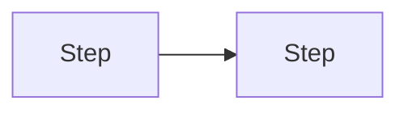
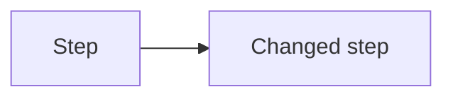

# <Initiative title>: design brief

## The change

<Who, what they are trying to do, what goes wrong today, what success looks like.>

## Current flow

| Step | What the user sees | Where it lives |
|------|--------------------|----------------|
| 1 | <description> | `<path>` |

## Proposed flow

**What changed:** <list>
**Entry points covered:** <list>

## Screens affected

| Screen or surface | Today | Change | Kind |
|-------------------|-------|--------|------|
| <name> | `<path>` | <what changes> | new / changed / affected |

## States

| State | <Screen 1> | <Screen 2> |
|-------|------------|------------|
| Default | <note> | <note> |
| Empty | | |
| Loading | | |
| Partial data | | |
| Error: <each error from the capability's table> | | |
| Error: network or server failure | | |
| Success and confirmation | | |
| Permission denied | | |
| Feature off (flag) | | |
| Long or unusual content | | |
| Offline or interrupted (mobile) | | |

## Copy needed

| Trigger | Current message (source) | User should then | Notes |
|---------|--------------------------|------------------|-------|
| <when> | "<text>" `<path:line>` or none | <next action> | <tone, length limits> |

## Components to reuse

| Component | Where | Use for |
|-----------|-------|---------|
| <name> | `<path>` | <purpose> |

## Accessibility

- Keyboard: <path through the flow>
- Screen readers: <labels; how errors are announced>
- Focus: <where focus goes after an error or success>
- Contrast and touch targets: <requirements>

## Constraints

- <Technical, platform, brand, legal, or timeline constraints>

## Open design questions

| # | Question | Owner |
|---|----------|-------|
| Q1 | <question> | <owner> |

## Expected back from design

- <Frames, prototypes, copy document>
