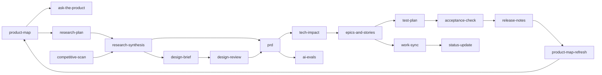

# PM Start

Answer two questions for the PM: **where are we** and **what should I do next**. Then
hand off to the skill that does it.

## Workflow

### 1. Check the state

Run from the product repo root:

```bash
python3 <this-skill-dir>/scripts/pm_status.py pm --repo .
```

It reports whether `pm/` exists, how fresh the product knowledge base is (commits behind
`HEAD`), open questions, and for each initiative: its stage, story counts, and the next
skill. Show the PM the report, trimmed to what matters.

### 2. Set up `pm/` if it is missing

Ask the PM four short questions (offer the defaults in brackets):

1. Product name [the repo name]
2. Which tracker the team uses: Jira, Linear, or none [none: markdown only]
3. Tracker project or team key, if any
4. Any folders the harness must not read (licensed, confidential, customer data) [none]

Then:
- Copy [templates/CONVENTIONS.md](templates/CONVENTIONS.md) to `pm/CONVENTIONS.md`.
- Create `pm/config.yaml` from [templates/config.yaml](templates/config.yaml) with the answers.
  Leave `platforms` and `audiences` empty; `product-map` fills them.
- Suggest running `product-map` next. It is the foundation for every other skill.

### 3. Route

If the PM said what they want, pick the skill from this table. If they did not, recommend
the first item under "Next" from the status report and show the table so they can choose.

| The PM wants to... | Skill | Writes |
|--------------------|-------|--------|
| Understand the product or a codebase | `product-map` | `pm/product/*` |
| Ask how something works or what happens if... | `ask-the-product` | `pm/product/faq.md` |
| Catch up after the code changed | `product-map-refresh` | Updated pages, `changelog.md` |
| Plan interviews or a study | `research-plan` | `research-plan.md` |
| Make sense of interviews, tickets, or feedback | `research-synthesis` | `research.md`, `brief.md` |
| Compare with competitors | `competitive-scan` | `competitive-scan.md` |
| Describe the flows and screens for a change | `design-brief` | `design.md` |
| Check designs or screenshots against the brief | `design-review` | `design-review.md` |
| Write a PRD or spec | `prd` | `prd.md` |
| Know what a change touches in the code, and the risks | `tech-impact` | `tech-impact.md` |
| Break work into epics and stories | `epics-and-stories` | `epics/`, `stories/` |
| Push stories to Jira or Linear, or pull status back | `work-sync` | `tracker:` fields in stories |
| Plan testing | `test-plan` | `test-plan.md` |
| Check a PR or branch against acceptance criteria | `acceptance-check` | `acceptance/` |
| Evaluate an AI or LLM feature | `ai-evals` | `evals/` |
| Write release notes | `release-notes` | `release.md` |
| Update stakeholders | `status-update` | `status/<date>.md` |

Initiative artifacts live in `pm/initiatives/<slug>/`. When the PM starts new work, agree
on a short slug (lowercase, hyphens, e.g. `guest-checkout`) and create the folder with a
README that follows the "Initiative README" section of `pm/CONVENTIONS.md`.

### 4. Hand off

If the chosen skill is installed, follow it. If it is not, tell the PM how to install it:

```bash
npx skills add bharal-sahab/pm-harness --skill <skill-name>
```

## The lifecycle

The skills chain through the files in `pm/`. Each one reads what earlier ones wrote, so
the PM never has to re-explain context.



Small changes can skip steps: a bug fix might go straight from `ask-the-product` to `prd`
or even `epics-and-stories`. Suggest the shortest path that still gives the team what
they need.

## Check your work

```bash
python3 <this-skill-dir>/scripts/check_pm.py pm --repo .
```
