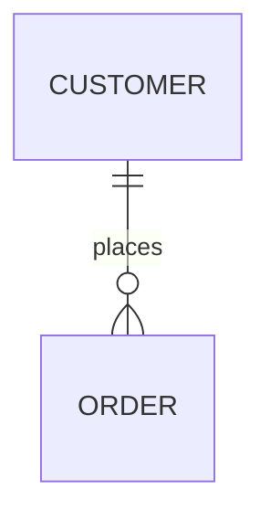

# Data model, in plain language

The "nouns" of the product: what is stored, how the pieces relate, and the states each
one moves through. Field-level detail only where it changes product behavior.

## Map

## Entities

### <Entity>

<What it represents, in user terms.> Defined in `<path/to/model.ts>`.

- **Key fields:** <field: meaning>
- **States:** `<state_a>` -> `<state_b>` (<what moves it>) `<path/to/enum.ts>`
- **Belongs to / has many:** <relations>

## Where the data lives

<One paragraph: database(s), caches, search indexes, third-party systems of record.>
