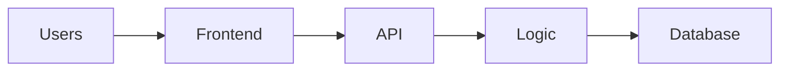

# How it is built (for PMs)

What you need to know about the architecture to write good specs and have good
conversations with engineering. No code required.

## The big picture

<Three to five sentences walking through the diagram.>

## The building blocks

| Block | What it is (plain words) | Why a PM should care | Where |
|-------|--------------------------|----------------------|-------|
| <Module> | <...> | <...> | `<path>` |

## Repository tour

| Folder | What lives there |
|--------|------------------|
| `<path>` | <...> |

## What makes changes easy or hard here

- <e.g. "New payment providers plug in without touching checkout"> `<path>`
- <e.g. "Changing order statuses touches many workflows"> `<path>`

## Technical terms you will hear

<Five to ten terms engineers use in this codebase, each with a one-line meaning.
Link to [domain-glossary.md](domain-glossary.md) for business terms.>
