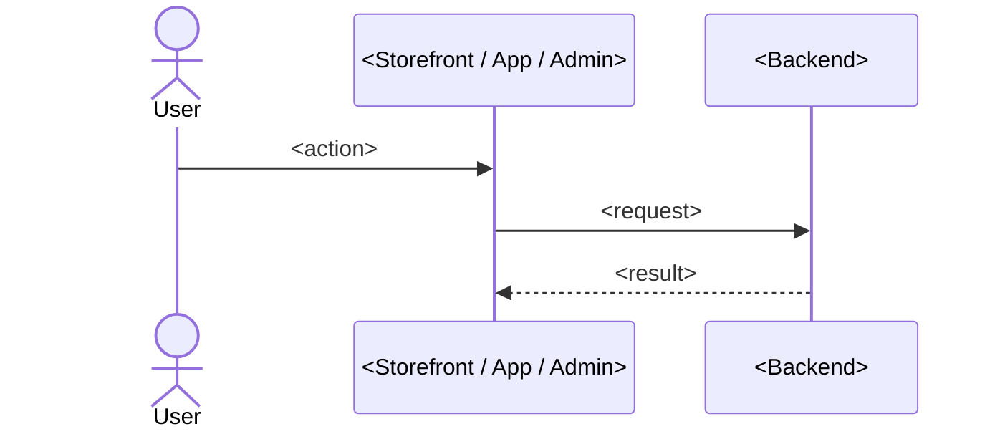

# Journey: <name>

**Actor:** <who>  **Trigger:** <what starts it>  **Outcome:** <what success looks like>

## The flow

## Step by step

| # | What the user does or sees | What the system does | Code |
|---|----------------------------|----------------------|------|
| 1 | <...> | <...> | `<path>` |

## Business rules

- <Rule> `<path>`

## What can go wrong

| Situation | What the user experiences | What the system does | Code |
|-----------|---------------------------|----------------------|------|
| <Payment declined> | <...> | <...> | `<path>` |

## Events and notifications

- `<event.name>`: <when it fires, who listens> `<path>`

## Open questions

- <Question the code could not answer>
